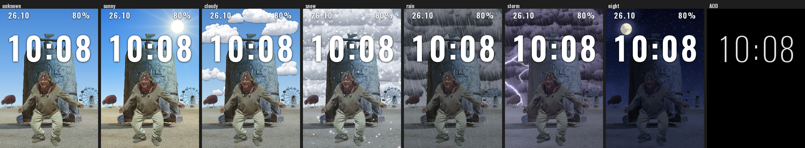

# Циферблаты «Кин-дза-дза» для Mi Band 9 Pro

Циферблаты в формате Lua/LVGL (экран 336×480), собираются в `.face` программой
[EasyFace](https://github.com/m0tral/EasyFace).

## Пепелац

Фон с Пепелацем, Триногой и колесом обозрения; небо меняется по погоде
(ясно, облачно, снег, дождь, гроза, неизвестно), с 21:00 до 06:00 ночное небо с фазой Луны.
По земле пританцовывает «КУ» (анимация 46 кадров, 24 к/с). Время по центру,
дата слева сверху, заряд справа сверху, есть AOD.

| Папка | Что внутри |
|---|---|
| `Pepelac_face/face/Pepelac_v4/` | Актуальный проект EasyFace (`Pepelac.fprj`, `app/lua/main.lua` и картинки, `AOD/`). Открыть в EasyFace и собрать `.face`. |
| `Pepelac_face/src/` | Скрипты-генераторы: `build_face.py` собирает проект целиком, `main_template.lua` — шаблон Lua, `skies.py` — фоны под погоду и Луна, `compose.py`/`masks.py` — сборка слоя земли из исходных картинок, `ku_preview.py`, `preview.py` — превью. Шрифт Oswald (OFL) в `fonts/`. |
| `Pepelac_face/skies/` | Готовые фоны `bg_<погода>.png`, слои неба `sky_<погода>.png`, фазы Луны. |
| `Pepelac_face/ground_*.png` | Слой земли с прозрачным небом (336×480 и мастер 1008×1440 для `skies.py`). |
| `Pepelac_face/ku_preview/`, `face/preview_*` | Превью. |
| корень | Исходные картинки (`Пепелац.jpg`, `Тринога*.jpg`, `Колесо обозрения.jpg`, `Фон пустыня.jpg`, `Back_clean.jpg`) и макет разметки `preview.png`. |

### Сборка

1. `pip install pillow numpy opencv-python scipy` (для `compose.py`/`masks.py` ещё `rembg`).
2. В скриптах путь к папке проекта задан константой `D` в начале файла
   (`/mnt/project-files/Kin-Dza_Dza/`) — замените на свой, например `C:/Kin-Dza_Dza/`.
3. `py skies.py` → `skies/`, затем `py build_face.py` → `face/Pepelac_<TAG>/`.
   Кадры «КУ» берутся из папки `КУ_кадры/` (101 PNG, в репозиторий не входят — около 27 МБ).
4. Браслет кэширует картинки по имени файла, поэтому при каждой новой версии меняйте
   `TAG` в `build_face.py` (сейчас `v4_`).
5. Открыть `.fprj` в EasyFace и собрать `.face`. Файл `.fprj` должен быть в ASCII без BOM.
   Превью в EasyFace у Lua-циферблатов чёрное — это нормально, проверять на браслете.

## Не вошло в репозиторий

- Первый циферблат **KinDzaDza** лежит в `C:\nginx-1.18.0-Mi8Pro` и сюда не попал.
- Старая версия `Pepelac_face/face/Pepelac/`, собранные `.face`, кадры `КУ_кадры/`,
  видео и GIF с «КУ».

## Готовый циферблат

`release/PepelacV4.face` — собранный циферблат v4, рядом превью. Он же приложен к релизу `v4`.
